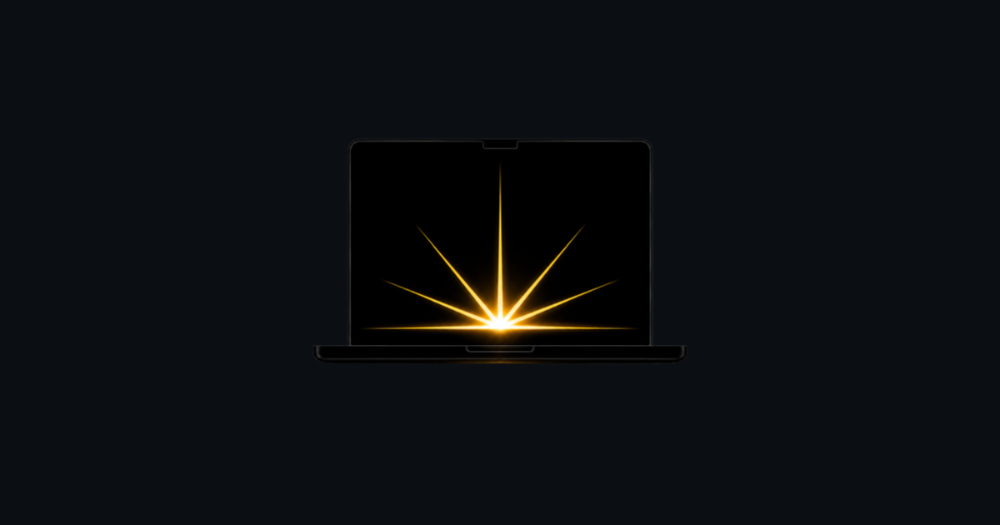

  

<h1 align="center">MaxCandela</h1>

<strong>27 Mac tools under one menu-bar icon — including an XDR brightness boost that takes your MacBook Pro screen past the limit macOS sets.</strong>

  <a href="https://maxcandela.com">maxcandela.com</a>

---

Your MacBook Pro's XDR display is rated for around **1,000 nits** of brightness —
but for everyday content, macOS caps it near **600**. The rest is reserved for
HDR video and normally sits unused. MaxCandela hands that reserve back to you.

One click, and your whole screen steps up to the brightness your hardware always
had — brighter for working in sunlight, on a bright desk, or any time 600 nits
just isn't enough.

## Two ways to use it

**🖥️ The Mac app** — a ☀️ in your menu bar. Open it to boost your entire
screen (every app, every window) or to reach the rest of the toolbox. You can
set a click on the icon to toggle the boost directly (Options ▸ Clicking the
Icon Toggles the Boost), and a keyboard shortcut, the Shortcuts app or a
`maxcandela://boost/toggle` link can switch it too.

**🌐 The website** — visit **[maxcandela.com](https://maxcandela.com)** and press
**Try the boost** to see the effect right in your browser, no install needed.
(The web demo brightens the site's own pages; the Mac app brightens everything.)

## Why people like it

- **Your whole Mac, brighter** — not just one window or one app.
- **One click** — turn the boost on from the ☀️ menu (or a single click on the
  icon, if you set it to), off the same way. No sliders, nothing to calibrate.
- **True colors** — a color-calibrated boost that keeps your display's profile
  intact. Brighter, never washed out.
- **Panel-safe** — it never pushes past the limits macOS itself allows for HDR,
  and it automatically eases off when your Mac runs hot.
- **Private** — no accounts. The boost never looks at your screen; the tools
  that do (Screenshot, Copy Text and Scan QR Code from Screen) ask for Screen
  Recording the first time you use them, and work on your Mac only. Anonymous
  usage statistics only, as described in the
  [privacy policy](https://maxcandela.com/privacy/).
- **Instantly reversible** — turn it off, or just quit, and your display returns
  to exactly where it was.

## The toolbox

The same ☀️ menu holds 26 more tools. **Free:** Keep Awake, Timer, Focus
(work/break cycles), Breaks (look-away reminders), clipboard tools with a short
history, Scratchpad, Color Picker, Generate (UUID, password, timestamp, QR
code), World Clock, a Calendar month view, Sound, a System read-out, Desktop
(hide desktop icons or the notch) and Extra Dim. **Pro:** Screenshot with
markup, Copy Text and Scan QR Code from Screen, a clipboard manager, File
Shelf, Dim Background Windows, Bluetooth quick-connect, App Volume (per-app
volume), Shortcuts, Next Meeting, Hide Menu Bar Icons (macOS 26 and earlier),
Warmth and the brightness boost. Every tool except the boost works on any Mac
running macOS 15.6 or later.

## Will the brightness boost work on my Mac?

You need a display with HDR headroom to unlock:

- **MacBook Pro 14″ / 16″** with an M1 Pro / M1 Max chip or newer (2021 and
  later), with the Liquid Retina XDR display
- **Pro Display XDR**

On those, MaxCandela can reach roughly 1,000 nits instead of the usual ~600.
Some other HDR displays have smaller amounts of headroom and work to varying
degrees.

**MacBook Air, iMac, and standard external monitors are not supported** — they
have no reserve brightness to release, no matter how new the chip is. (An M3
MacBook Air can't be boosted; a 2021 MacBook Pro can.) On those Macs MaxCandela
tells you so instead of pretending to work. You can check your own display for
free at [maxcandela.com](https://maxcandela.com) before buying — if the browser
demo doesn't brighten your screen, the app won't either.

Requires macOS 15.6 or later.

## Pricing

Free to download; the everyday tools and Extra Dim are free to keep. **Pro**
is free to try for **14 days**, fully unlocked. After that:

- **$9.99** once — yours for life, or
- **$0.99 / month**

One purchase covers every Mac on your Apple ID. The trial clock starts when your
Apple ID first downloads the app, so open it soon after installing to get the
full 14 days.

Got a promo code? Use **Purchases ▸ Redeem Code…** in the ☀️ menu, or redeem it at
[apps.apple.com/redeem](https://apps.apple.com/redeem). Codes unlock the app
straight away — they don't wait for the trial to finish.

## A note on heat & battery

More brightness uses more power and generates more heat — that's physics, the
same as playing HDR video. A boosted display genuinely runs warm, so MaxCandela
manages that for you rather than leaving it to the OS.

It keeps track of how hard and how long it has been driving your panel and
steadily **eases the boost down** as that adds up, settling at a brightness your
Mac can hold instead of running flat out indefinitely. If the Mac gets genuinely
hot it **stops boosting altogether** and hands the display back to macOS, then
brings it back once things cool down. The ☀️ menu tells you which is happening.

Turn it off any time to go back to normal — that's never blocked, whatever the
temperature.

## Links

- 🌐 Website — [maxcandela.com](https://maxcandela.com)
- 🔒 [Privacy Policy](https://maxcandela.com/privacy/)
- 📄 [Terms of Use](https://maxcandela.com/terms/)
- 💬 [Support](https://maxcandela.com/support/) — or email
  [hello+maxcandela@nelera.net](mailto:hello%2Bmaxcandela@nelera.net)

## License

MIT — see [LICENSE](./LICENSE).

## Disclaimer

MaxCandela is an independent project and is not affiliated with, endorsed by, or
sponsored by Apple Inc. "MacBook Pro", "Liquid Retina XDR", and "Pro Display
XDR" are trademarks of Apple Inc. Use at your own risk.
